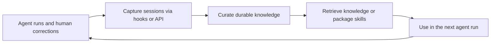

  

<h3 align="center">Help your agents learn from experience.</h3>

  Agents generate valuable experience every time they work: successful approaches,  
  failed attempts, and human corrections. Stash captures that history and makes  
  its lessons available to future runs.

  
  
  
  

This repository provides the open-source foundation: trace collection, persistent
knowledge, and reusable skills, accessible through a [Python SDK](sdk/README.md),
REST API, MCP, and CLI. It works alongside your existing agents and models.

[**Try Stash**](https://app.joinstash.ai) · [**Read the docs**](https://www.joinstash.ai/docs)

For CLI setup, local development, and self-hosting, see [Running this repository](docs/running-stash.md).

## How it works

1. **Capture experience.** Hooks for coding agents record prompts, tool calls,
   and responses when session recording is enabled. Use the SDK or API to send
   events from your own agents.
2. **Extract durable lessons.** A scheduled curator reads new sessions and
   source material, then updates linked pages in your Memory wiki. The knowledge
   stays available after the original session ends.
3. **Make lessons reusable.** Agents search and read that knowledge through the
   CLI, MCP, API, or virtual filesystem. You and your agents can package related
   instructions and files into a Skill: a folder containing a `SKILL.md`.
4. **Carry them into future runs.** Install skills into your agent with
   `stash skills install`. Installed skills auto-update at session start, so
   changes to shared instructions can reach the next run without changing the
   underlying model's weights.

### Example: a correction becomes a reusable instruction

Illustrative workflow:

| Stage | What happens |
|---|---|
| **Trace** | An agent proposes a database migration. The reviewer points out that it would discard existing customer data. |
| **Durable lesson** | Record the project rule: schema changes must migrate existing data forward. |
| **Reusable skill** | Package a migration checklist that requires a data migration and verification that existing records survive. |
| **Next run** | The agent loads the checklist while planning another schema change. Reviewers check whether it applied the lesson. |

The output is inspectable knowledge and instructions that another agent can
read, use, and revise. Whether they improve results should be checked on
subsequent tasks.

In an [internal experiment](https://henrydowling.com/agent-velocity.html), we
measured a **49% speedup** for long-running Claude Code instances using Stash.
See the experiment for its setup and results.
