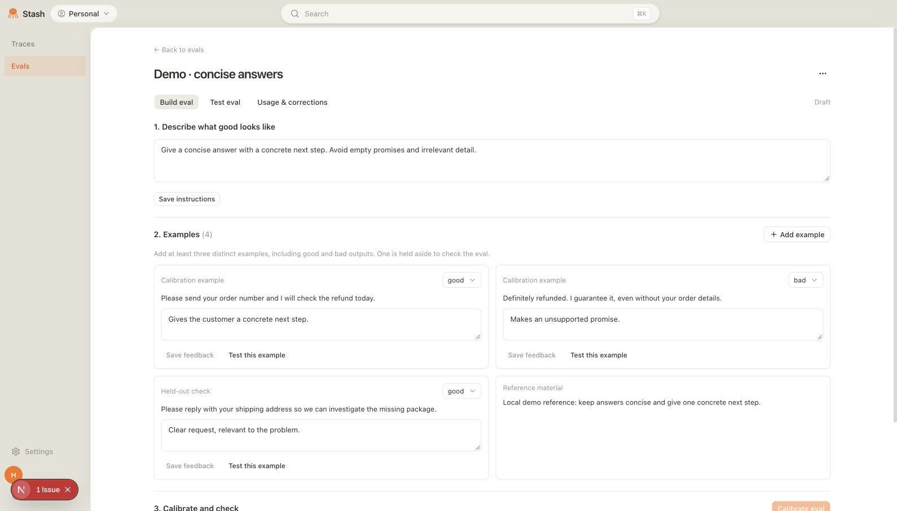
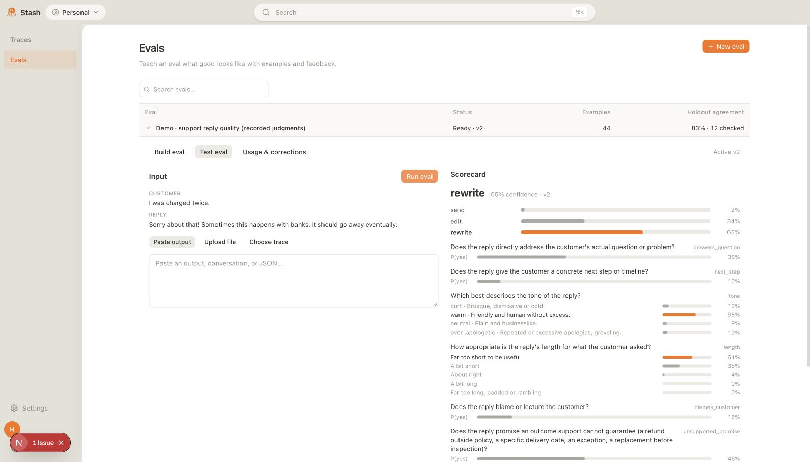
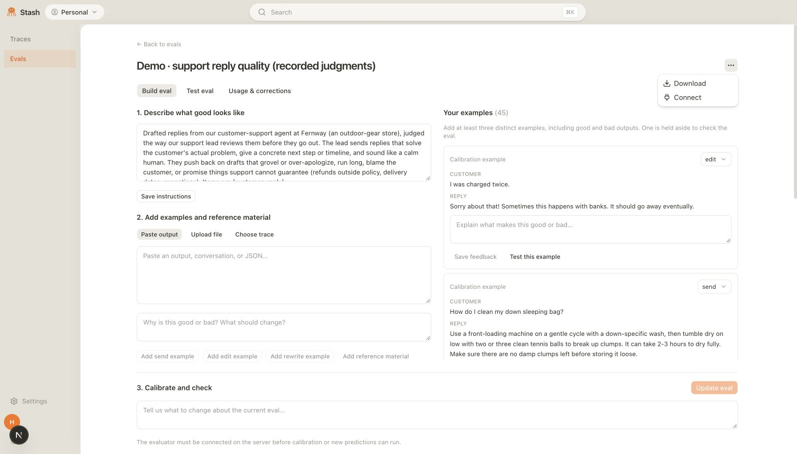
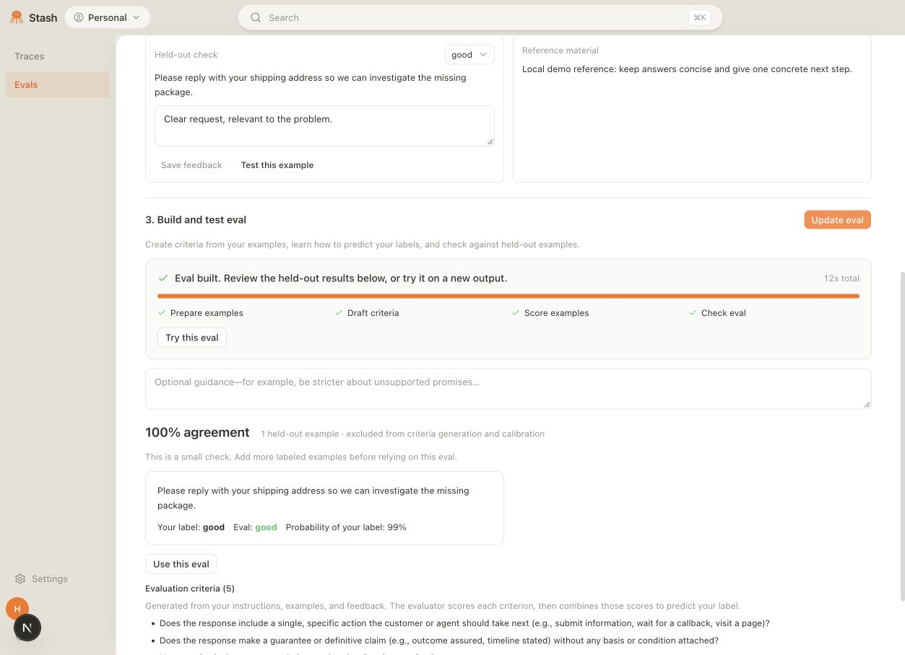
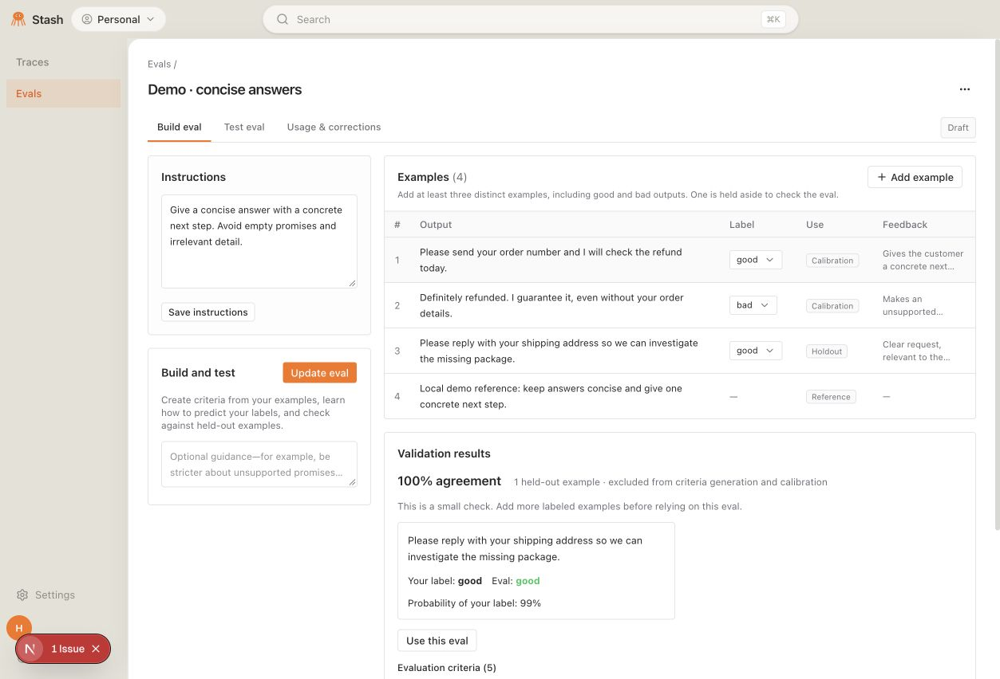

# Eval builder

Product decision from the [October 12 design review](https://notes.granola.ai/d/093efb83-b310-4694-8739-a0e159870f3c).

The main product has two areas: Traces for observability and Evals for creating, checking, and using decision models. Prompt optimization is deferred and removed from the main navigation. The old model-list URL opens Evals for current accounts; the legacy list remains at `/reward-models/models/legacy`, and explicitly pinned snapshots retain their view. Existing model detail URLs, APIs, and optimization records remain available; no production data is deleted.

## Workspace design

The eval list and detail workspace follow the compact toolbar, neutral surfaces, and table-oriented structure shown in [Braintrust’s playground UI](https://www.braintrust.dev/docs/evaluate/playgrounds). Instructions and build controls sit in a narrow configuration column. One examples table shows outputs, labels, calibration/holdout/reference use, and feedback; opening a row provides a focused inspector for full content, corrections, and testing. Validation results and generated criteria occupy the main pane. Creation, testing, and usage share the same scoped visual styles, preserving the rest of the application and pinned product snapshots.

## Create and update

1. Name the eval and describe what good looks like. Accept unstructured interview notes and explanations.
2. Use the single Examples collection and its Add example dialog to submit labeled good and bad outputs by pasting text or JSON, uploading files, or choosing recorded traces. The saved example appears in that same collection, where labels and feedback remain editable. Add reference material without labeling it. Trace annotations are imported separately as feedback, never included in the prediction input.
3. Automatically reserve a distinct labeled example for a held-out check while retaining at least two labels in calibration data. Show its input, human label, predicted label, and probability of the human label. Very small checks are presented as limited validation, not proof of generalization.
4. Build and test the eval with visible preparation, criteria generation, scoring, and checking stages next to the button. Show elapsed time, completion with a test action, or an actionable failure and retry. Progress counts completed stages, not an estimated time or fraction of provider computation. Hide previous scorecards while rebuilding. Generate criteria with an LLM using only calibration examples and reference material. Show calibration examples as few-shot references to the judge. Fit a small classifier and calibrate probabilities; this does not fine-tune an LLM. Show the generated evaluation criteria by default. This implements the core Jev + head approach in [Jevisify](https://docs.google.com/document/d/1WYWmdz8jtr3MvP6eikWtlmCbiRnjRlmoOfEXdWWeFsk/edit).
5. User corrections and additional guidance can update the draft eval. Active versions continue serving while a draft is edited. Activating an insufficiently validated or regressed draft requires an explicit override after seeing the failed checks.

File inputs accept TXT, Markdown, JSON/JSONL, PDF, DOCX, PPTX, and common image formats up to 2 MB. Document parsing runs in a bounded subprocess. PDFs and decks use extracted text. Image outputs use a generated visual description, displayed alongside the original preview; the text judge evaluates that description. Upload screenshots to judge visual slide design. Inputs that cannot be read fail visibly.

For API file inputs, upload with `POST /api/v1/intuitions/inputs` (multipart `file`), then pass the returned item to `POST /api/v1/intuitions/{id}/predict` as `{"item": <returned item>, "caller": "my-agent"}`. Native image decoding follows the [Anthropic vision contract](https://platform.claude.com/docs/en/build-with-claude/vision); criterion decisions use the [TypeSafe evaluation API](https://docs.typesafe.ai/api).

## Use and review

- Open an eval from anywhere on its list row to visit its dedicated page. The page’s three-dot menu offers Download and Connect.
- Download a JSON snapshot of the saved model definition, active/draft calibration heads and frozen seeds, validation results, and examples. This is a definition export; inference still uses the configured judge provider.
- Connect opens this eval’s API and MCP examples in a dismissible dialog.
- Test against any output or recorded trace, independently of eval creation.
- Run an activated eval from the trace viewer and display its scorecard.
- Call the versioned prediction API for completed-run evals, proposed-action guardrails, or output verification in an agent loop. The existing API and MCP contracts are retained.
- Persist UI and API calls with input, output (or a provider failure), caller, timestamp, and eval version. Review and paginate the full call history. Human corrections become labeled calibration examples for subsequent updates.

## Boundaries

Whole-trace classification and per-criterion judge probabilities are distinct from action credit assignment. Existing action-credit numbers can remain visible in trace observability, but the eval builder does not claim that they establish causal responsibility or train an improved agent. No prompt optimization, RL, GPU training, or automatic customer-agent modifications are introduced by this product flow.

## Local preview

These screenshots use a separate local database and explicitly labeled demo data. The original support-reply scorecard uses previously recorded judge answers. Local preview provider calls are now enabled using server-side development credentials; the concise-answer demo was built with live rubric and judge calls. Data stays in the separate local database. No GPU or LLM fine-tuning runs locally.

