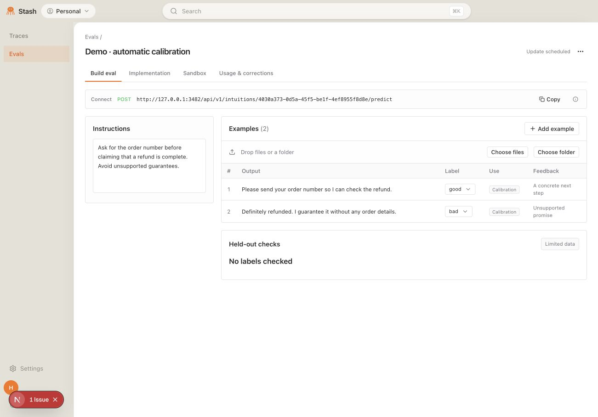
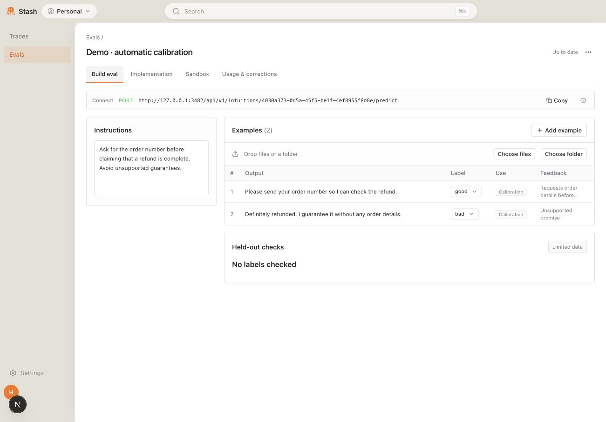
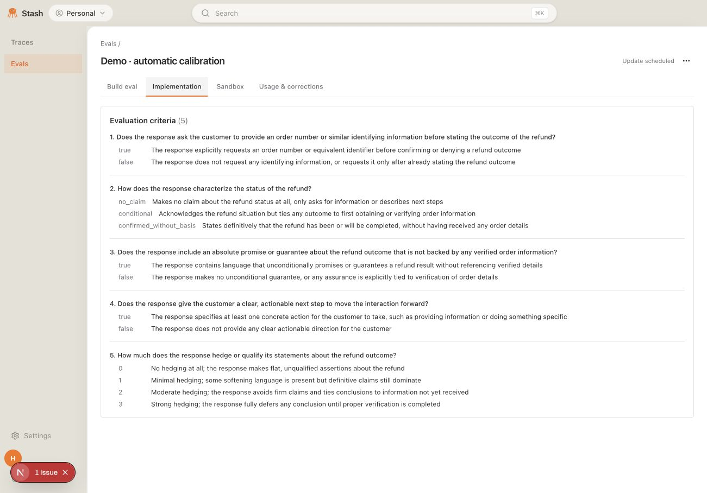
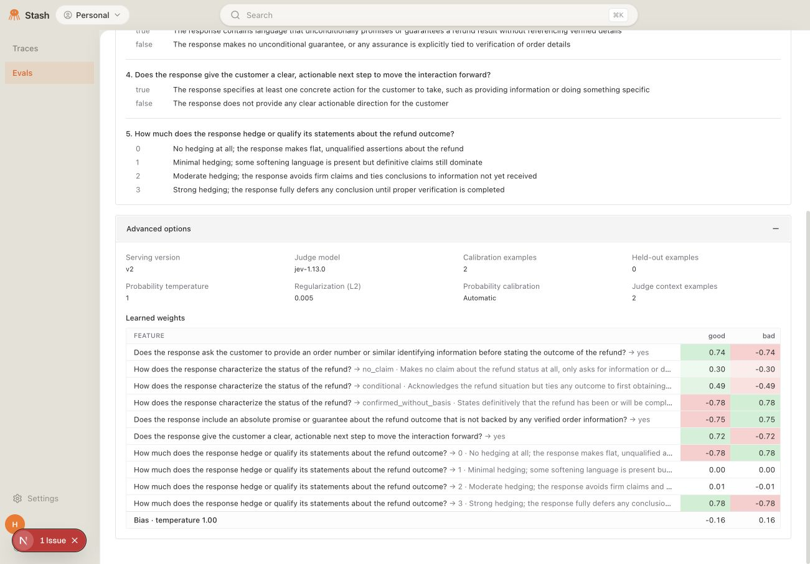
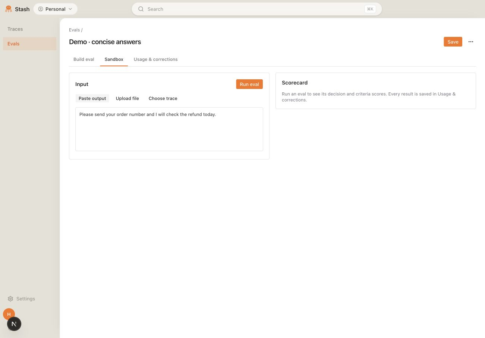
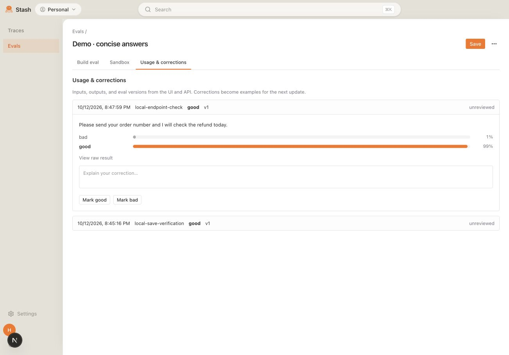
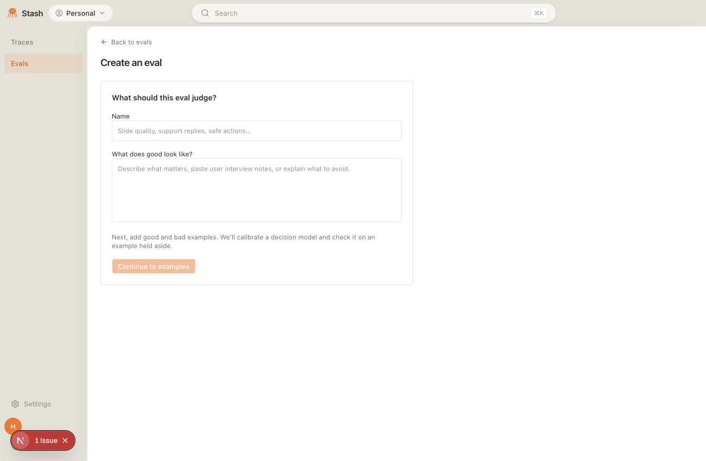

# Eval builder

Product decisions from the [October 12 design review](https://notes.granola.ai/d/093efb83-b310-4694-8739-a0e159870f3c) and [automatic calibration review](https://notes.granola.ai/d/8bad13b6-73f9-4c2e-8ba8-59323a030af3).

The main product has two areas: Traces for observability and Evals for creating, checking, and using decision models. Prompt optimization is deferred and removed from the main navigation. The old model-list URL opens Evals for current accounts; the legacy list remains at `/reward-models/models/legacy`, and explicitly pinned snapshots retain their view. Existing model detail URLs, APIs, and optimization records remain available; no production data is deleted.

## Workspace design

The eval list and detail workspace follow the compact toolbar, neutral surfaces, and table-oriented structure shown in [Braintrust’s playground UI](https://www.braintrust.dev/docs/evaluate/playgrounds). Instructions sit in a narrow configuration column and save automatically. The toolbar shows the persisted update state, with no manual Save or retrain action. One examples table shows outputs, labels, calibration/holdout/reference use, and feedback; opening a row expands a focused inspector directly beneath it for full content, corrections, and sandbox inspection. Add example and the API request example expand inline. On Build eval, a Connect row shows this eval's full POST endpoint and offers a copy control; Connect is removed from the menu. There is no separate activation control or Draft/Active status in the workspace. These flows use no modal overlays. Held-out checks stay in Build eval; the dedicated Implementation tab displays the complete rubric, including answer options and definitions, by default. A collapsed Advanced options section beneath the rubric shows the serving version, judge model, training/holdout counts, probability temperature, L2 regularization, confidence-calibration policy, frozen context count, and read-only learned weights/bias. Small sample checks carry a Limited data badge and show matched-label counts. Inline panels use a minus icon to collapse. Creation, testing, and usage share the same scoped visual styles, preserving the rest of the application and pinned product snapshots.

## Create and update

1. Name the eval and describe what good looks like. The creation page includes Back to evals above the form. Accept unstructured interview notes and explanations.
2. Use the single Examples collection and its inline Add example form to submit labeled good and bad outputs by pasting text or JSON, uploading files, or choosing recorded traces. The saved example appears in that same collection, where labels and feedback remain editable. Add reference material without labeling it. Trace annotations are imported separately as feedback, never included in the prediction input.
3. Automatically reserve a distinct labeled example for a held-out check while retaining at least two labels in calibration data. Show its input, human label, predicted label, and probability of the human label. Very small checks are presented as limited validation, not proof of generalization.
4. Edits persist automatically; a durable server-side job waits one minute after the latest change, then updates and applies the evaluator even if the browser leaves the page. New file imports remain unlabeled and require review before calibration. At least two distinct reviewed inputs covering two labels are needed to start. If no input can be held aside while preserving both training labels, show no labels checked; do not invent validation.
5. The initial update generates criteria from instructions, calibration examples, and reference material. Later example additions and label/feedback corrections retain the existing rubric and frozen judge context, reuse cached features, score only new reviewed inputs, and refit the small logistic calibration head. Instruction or reference-material changes regenerate criteria and features. This implements the core Jev + head approach in [Jevisify](https://docs.google.com/document/d/1WYWmdz8jtr3MvP6eikWtlmCbiRnjRlmoOfEXdWWeFsk/edit); it does not fine-tune an LLM. Feedback is persisted; with frozen criteria and judge context, note-only corrections do not independently change cached numeric features.
6. The toolbar shows scheduled/running/completed states and stages; provider errors remain visible and retry automatically up to three attempts, then offer Retry. Revision checks prevent publishing an update computed before a later edit. The previous evaluator continues serving until a complete update succeeds. Quality measurements, including Limited data, remain visible without an activation or approval workflow. Publication uses the existing force option for quality gates; stale or missing fitted heads remain errors.

Choose multiple files, choose a folder, or drop files/a folder anywhere on the examples collection. Imports are bounded to 100 files and 20 MB total, skip hidden folder entries, show progress and per-file failures, and allow retrying unreadable files without repeating successful imports. File inputs accept TXT, Markdown, JSON/JSONL, PDF, DOCX, PPTX, and common image formats up to 2 MB. Document parsing runs in a bounded subprocess. PDFs and decks use extracted text. Image outputs use a generated visual description, displayed alongside the original preview; the text judge evaluates that description. Upload screenshots to judge visual slide design. Inputs that cannot be read fail visibly.

For API file inputs, upload with `POST /api/v1/intuitions/inputs` (multipart `file`), then pass the returned item to `POST /api/v1/intuitions/{id}/predict` as `{"item": <returned item>, "caller": "my-agent"}`. Native image decoding follows the [Anthropic vision contract](https://platform.claude.com/docs/en/build-with-claude/vision); criterion decisions use the [TypeSafe evaluation API](https://docs.typesafe.ai/api).

## Use and review

- Open an eval from anywhere on its list row to visit its dedicated page. The page’s three-dot menu offers Download.
- Download a JSON snapshot of the saved model definition, active/draft calibration heads and frozen seeds, validation results, and examples. This is a definition export; inference still uses the configured judge provider.
- On Build eval only, the Connect row displays this eval's POST endpoint and copy control. A subtle info icon with an API request details tooltip expands an authenticated trace-shaped cURL request and MCP example inline. Calls to this endpoint are logged with input, output, caller, version, and timestamp and appear in Usage & corrections.
- Open in sandbox preloads a saved example directly into the editable sandbox input; Run eval explicitly scores it. Structured examples appear as JSON and retain their object input type when edited; invalid JSON disables the run until corrected. This inspects criterion answers and decisions, rather than providing independent evidence on examples used to build the eval. Test against any new output or recorded trace independently of eval creation.
- Sandbox and normal API calls use the same saved evaluator. Editing instructions does not silently switch either to a different test version. After an automatic update succeeds, both use the updated version.
- Run a saved eval from the trace viewer and display its scorecard.
- Call the versioned prediction API for completed-run evals, proposed-action guardrails, or output verification in an agent loop. The existing API and MCP contracts are retained.
- Persist UI and API calls with input, output (or a provider failure), caller, timestamp, and eval version. Review and paginate the full call history. Human corrections become labeled calibration examples for subsequent updates.

## Boundaries

Whole-trace classification and per-criterion judge probabilities are distinct from action credit assignment. Existing action-credit numbers can remain visible in trace observability, but the eval builder does not claim that they establish causal responsibility or train an improved agent. No prompt optimization, RL, GPU training, or automatic customer-agent modifications are introduced by this product flow.

## Deployment and recovery

Apply migration **0237** before serving the updated UI/API. Restart the API, Celery default worker, heavy worker, and beat so they register the new tasks. Beat reconciles due updates every ten seconds; fitting runs on the heavy queue. The scheduler claims jobs before dispatch, resets failed broker deliveries, and recovers queued/running leases after fifteen minutes. The task has a ten-minute soft timeout and eleven-minute hard timeout. These changes add no GPU or LLM weight training.

Auto updates are enabled when a model enters the new workspace. Existing legacy models without an update row retain their manual API behavior. Owner checks cover enable/status/retry and all mutations. The SQL revision is locked during publication so an older job cannot replace an evaluator after a newer edit. The migration is additive and its downgrade removes only the update queue table.

## Local preview

These screenshots use a separate local database and synthetic demo data. Two uploaded text examples were labeled good/bad, and a live provider-backed initial update ran after the real one-minute deadline without a browser or manual build action. It persisted version 1 with five criteria and a fitted calibration head, with zero held-out checks. A later feedback edit produced version 2 after the real one-minute delay with unchanged criteria. The default prediction endpoint returned version 2, and its good decision and caller were visible in Usage & corrections. Production Celery dispatch and recovery are covered by database-backed tests; the local preview uses an in-process poller invoking the same update service rather than a live broker.

